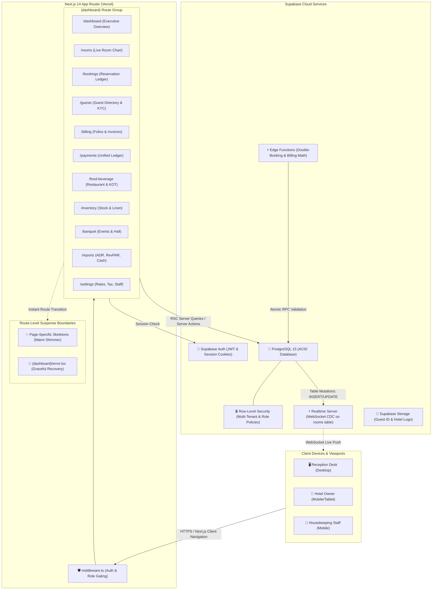
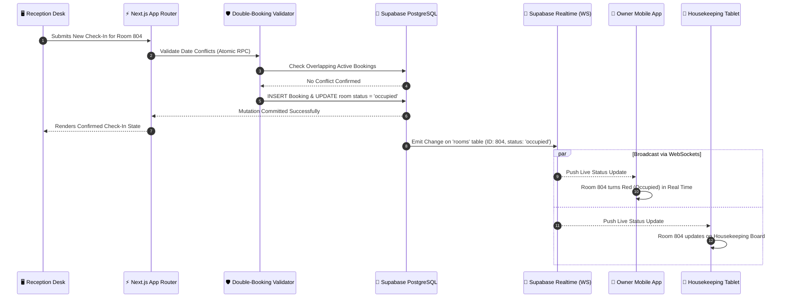
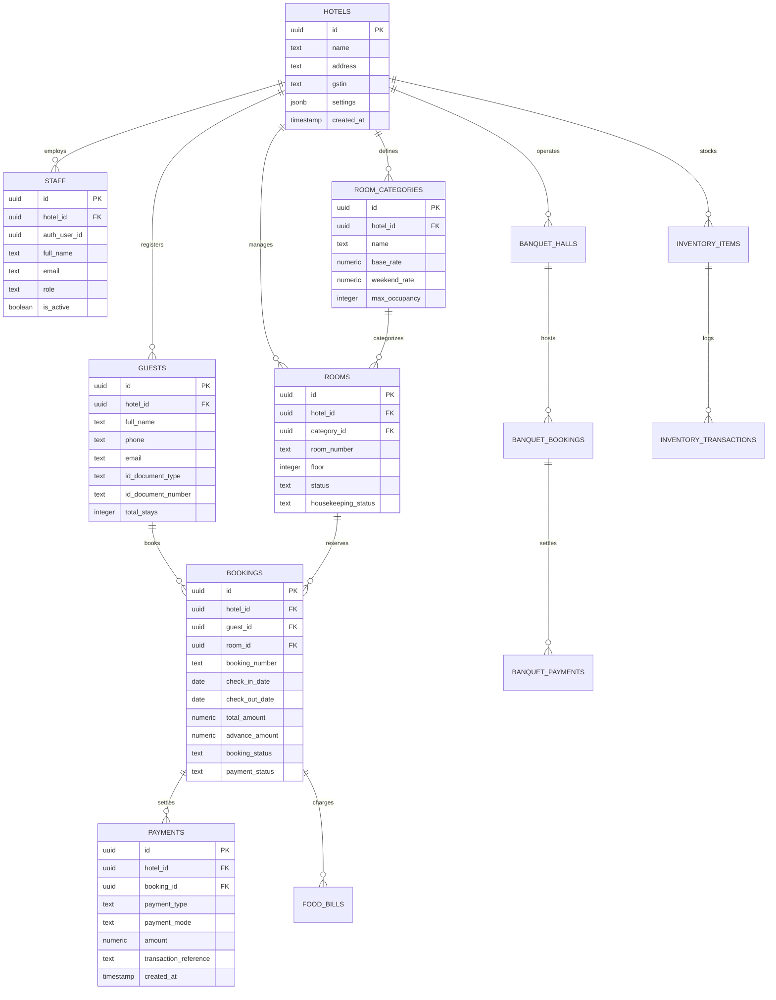

# 🌿 Hotel Greenery View PMS — Hotel Control Centre

[](https://nextjs.org/)
[](https://react.dev/)
[](https://www.typescriptlang.org/)
[](https://tailwindcss.com/)
[](https://supabase.com/)

A modern, high-performance, single-property **Property Management System (PMS) and Hotel Control Centre** engineered for [Hotel Greenery View](https://hotelgreeneryview.com). 

Designed to empower hotel staff—from front-desk receptionists to housekeeping and property owners—with a live, unified operational dashboard. Built on a zero-recurring-cost infrastructure stack combining Next.js 14 App Router and Supabase PostgreSQL with real-time WebSocket synchronization.

---

## 📑 Table of Contents

- [1. Executive Summary & Vision](#1-executive-summary--vision)
- [2. System Architecture](#2-system-architecture)
  - [High-Level Architectural Diagram](#high-level-architectural-diagram)
  - [Realtime Synchronization Flow](#realtime-synchronization-flow)
  - [Database Entity-Relationship Diagram (ERD)](#database-entity-relationship-diagram-erd)
- [3. The 11 Core Operating Modules](#3-the-11-core-operating-modules)
- [4. Role-Based Access Control (RBAC)](#4-role-based-access-control-rbac)
- [5. Performance & UX Architecture](#5-performance--ux-architecture)
  - [Page-Specific Skeleton Loading System](#page-specific-skeleton-loading-system)
  - [Hardware-Accelerated Warm Shimmer](#hardware-accelerated-warm-shimmer)
- [6. Technology Stack](#6-technology-stack)
- [7. Directory & Project Structure](#7-directory--project-structure)
- [8. Getting Started](#8-getting-started)
  - [Prerequisites](#prerequisites)
  - [Environment Setup](#environment-setup)
  - [Installation & Running Locally](#installation--running-locally)
- [9. Deployment & Production Operations](#9-deployment--production-operations)

---

## 1. Executive Summary & Vision

Hotels historically operate with fractured tools: pen-and-paper registers, disconnected spreadsheet ledgers, separate restaurant bills, and manual phone calls to check room cleaning status. 

**Hotel Greenery View PMS** consolidates property management into a single, intuitive interface:

- **1-Minute Walk-In Check-In:** Front desk reception can create reservations, assign rooms, record ID proof, and issue keys in under 60 seconds.
- **Zero Double-Bookings:** Server-side date-overlap validation guarantees conflicting reservations are impossible.
- **Sub-Second Realtime Synchronization:** When reception marks a room as *Occupied* or housekeeping marks a room *Clean*, all active screens (desktop terminals, owner smartphones, housekeeping tablets) update instantly via WebSockets without manual refreshes.
- **Unified Departmental Ledger:** Cross-department collections across Accommodation, Banquet Events, and Food & Beverage POS feed into a consolidated financial registry.
- **Zero Ongoing Infrastructure Cost:** Architected to run entirely within free-tier limits on Vercel and Supabase for single-property scale.

---

## 2. System Architecture

### High-Level Architectural Diagram

The system employs a server-first Next.js 14 App Router architecture backed by Supabase Managed Postgres with Row-Level Security (RLS) and real-time CDC (Change Data Capture) push notifications.



---

### Realtime Synchronization Flow

A core architectural pillar is immediate state synchronization across distributed hotel terminals.



---

### Database Entity-Relationship Diagram (ERD)

Every entity is scoped by `hotel_id` to guarantee clean data isolation and future-proof multi-property expansion.



---

## 3. The 11 Core Operating Modules

| Module | Route | Key Capabilities |
|---|---|---|
| **1. Dashboard** | `/dashboard` | Operational control centre: real-time room occupancy cards, 6 quick-action shortcuts, floor-by-floor room grid, today's collection summary, and arrivals/departures tracking. |
| **2. Room Chart** | `/rooms` | Visual live accommodation grid across 19 units (18 Rooms 801–818 + Basement Family Suite). Realtime housekeeping toggles (Clean / Dirty / Inspected), floor grouping, and category filters. |
| **3. Bookings** | `/bookings` | Unified reservation registry with debounced search, date ranges, calendar schedule view, automated status tracking (*Confirmed*, *Checked In*, *Checked Out*, *Cancelled*), and check-in workflows. |
| **4. Guest Directory** | `/guests` | Searchable guest profiles, contact records, repeat-stay identification, masked ID document records (Aadhaar, Passport, Driving License), and lifetime stay history. |
| **5. Billing & Folios** | `/billing` | Guest folio management: combines room charges, extra nights, and room-service food bills. Configurable GST / Non-GST toggles with real-time tax calculation and A4 printable statements. |
| **6. Payments Ledger** | `/payments` | Unified cross-department financial transaction ledger covering Rooms, Banquet events, and F&B sales. Filter by payment method (Cash, UPI, Card, Bank Transfer) with CSV export. |
| **7. Food & Beverage** | `/food-beverage` | Restaurant POS & Room Service: live Kitchen Order Tickets (KOT), dining bill generation, daily food revenue analytics, and menu item pricing control. |
| **8. Inventory & Assets** | `/inventory` | Property asset management for linens, toiletries, pantry consumables, and appliances. Low-stock alerts, damaged asset logs, wastage records, and replacement scheduling. |
| **9. Banquet Hall** | `/banquet` | Event booking manager: half-day & full-day reservation slots, convention and wedding hosting, advance collection tracking, and amenity management. |
| **10. Reports & Analytics** | `/reports` | Executive performance intelligence: Average Daily Rate (ADR), Revenue per Available Room (RevPAR), occupancy curves, daily cash reconciliation audit, and P&L analytics. |
| **11. Settings** | `/settings` | Property configuration: staff account credentialing, role permission assignments, seasonal room category pricing, and hotel GST / tax profile setup. |

---

## 4. Role-Based Access Control (RBAC)

Security is enforced at two distinct layers:
1. **Next.js Middleware (`middleware.ts`)**: Evaluates staff authentication and route permission rules on every incoming request.
2. **PostgreSQL Row-Level Security (RLS)**: Enforces database-level row isolation even if UI elements are manipulated.

| Module / Capability | 👑 Owner | 🛡️ Manager | 🛎️ Reception | 🧹 Housekeeping |
|---|:---:|:---:|:---:|:---:|
| **Dashboard Overview** | Full Access | Full Access | Full Access | Read-Only Summary |
| **Room Chart Matrix** | Full Access | Full Access | Full Access | Housekeeping Status Only |
| **Bookings & Check-In** | Full Access | Full Access | Full Access | ❌ No Access |
| **Billing & Folios** | Full Access | Full Access | Full Access | ❌ No Access |
| **Payments Ledger** | Full Access | Full Access | Full Access | ❌ No Access |
| **Guest KYC Directory** | Full Access | Full Access | Full Access | ❌ No Access |
| **Food & Beverage POS** | Full Access | Full Access | Full Access | Kitchen KOT Only |
| **Inventory & Assets** | Full Access | Full Access | Read-Only | Report Damage & Usage |
| **Banquet Hall** | Full Access | Full Access | Create & View | Read-Only Events |
| **Executive Reports (ADR/RevPAR)** | Full Access | Full Access | ❌ No Access | ❌ No Access |
| **Settings & Staff Management** | Full Access | ❌ No Access | ❌ No Access | ❌ No Access |

---

## 5. Performance & UX Architecture

### Page-Specific Skeleton Loading System

To achieve an instantaneous, native-feeling desktop and mobile experience, switching between sidebar modules utilizes dedicated **route-level skeleton loaders**:

- **Persistent Application Shell**: The sidebar, hotel logo, top bar, date, and user account switcher reside in the persistent layout and never unmount or flash during navigation.
- **Immediate Route Suspense**: Every module features a custom `loading.tsx` component that maps 1-to-1 to the physical dimensions, margins, cards, badges, and tables of the target page.
- **Zero Layout Shifts**: Skeletons match exact final content geometry, preventing content jumping when API requests resolve.
- **Rapid Navigation Resiliency**: Next.js automatically aborts obsolete background RSC streams if the user clicks through multiple tabs rapidly, eliminating stale state conflicts.

### Hardware-Accelerated Warm Shimmer

Skeletons adhere to the Hotel Greenery View PMS warm aesthetic (neutral sand `#EAE3D6` and cream tones):

```css
.pms-skeleton {
  @apply relative overflow-hidden rounded bg-brand-sand-dark/65;
}

.pms-skeleton::after {
  content: '';
  position: absolute;
  inset: 0;
  transform: translateX(-100%);
  background: linear-gradient(
    90deg,
    transparent 0%,
    rgba(255, 255, 255, 0.45) 50%,
    transparent 100%
  );
  animation: pmsShimmer 1.5s cubic-bezier(0.4, 0, 0.2, 1) infinite;
}

/* Accessibility: respect user motion preferences */
@media (prefers-reduced-motion: reduce) {
  .pms-skeleton::after {
    animation: none !important;
    display: none !important;
  }
}
```

---

## 6. Technology Stack

- **Framework**: [Next.js 14 (App Router)](https://nextjs.org/)
- **Language**: [TypeScript 5.5](https://www.typescriptlang.org/)
- **UI & Design System**: [Tailwind CSS 3.4](https://tailwindcss.com/) with custom design tokens (Brand Forest `#1F3D3A`, Brand Sand `#F6F2EC`)
- **Typography**: Google Fonts via `next/font`: *Fraunces* (Warm Luxury Editorial Serif) & *Inter* (High-Legibility Modern Sans)
- **Database & Auth**: [Supabase](https://supabase.com/) (PostgreSQL 15, Row-Level Security, Edge Functions)
- **Realtime Layer**: Supabase Realtime WebSocket client (`@supabase/ssr`, `@supabase/supabase-js`)
- **Icons**: [Lucide React](https://lucide.dev/)
- **Validation**: [Zod 3.23](https://zod.dev/)

---

## 7. Directory & Project Structure

```text
Booking_Software/
├── app/                                 # Next.js 14 App Router
│   ├── (auth)/                          # Unauthenticated auth routes
│   │   └── login/                       # Staff login & session creation
│   ├── (dashboard)/                     # Authenticated PMS module routes
│   │   ├── layout.tsx                   # Persistent sidebar, top bar & AuthProvider
│   │   ├── loading.tsx                  # Root fallback loading skeleton
│   │   ├── error.tsx                    # In-dashboard graceful error boundary
│   │   ├── dashboard/                   # Module 1: Dashboard overview
│   │   ├── rooms/                       # Module 2: Room chart & matrix
│   │   ├── bookings/                    # Module 3: Booking registers & calendar
│   │   ├── guests/                      # Module 4: Guest directory & KYC
│   │   ├── billing/                     # Module 5: Billing folios & invoices
│   │   ├── payments/                    # Module 6: Cross-department ledger
│   │   ├── food-beverage/               # Module 7: Restaurant POS & KOT
│   │   ├── inventory/                   # Module 8: Stock, assets & linen
│   │   ├── banquet/                     # Module 9: Banquet hall & events
│   │   ├── reports/                     # Module 10: Performance intelligence & ADR
│   │   └── settings/                    # Module 11: Hotel, staff & rates
│   └── globals.css                      # Design system tokens & shimmer animations
├── components/
│   ├── skeletons/                       # Page-specific skeleton loaders
│   │   ├── Skeleton.tsx                 # Reusable skeleton primitive
│   │   ├── DashboardSkeleton.tsx
│   │   ├── RoomsSkeleton.tsx
│   │   ├── BookingsSkeleton.tsx
│   │   ├── GuestsSkeleton.tsx
│   │   ├── BillingSkeleton.tsx
│   │   ├── PaymentsSkeleton.tsx
│   │   ├── FoodBeverageSkeleton.tsx
│   │   ├── InventorySkeleton.tsx
│   │   ├── BanquetHallSkeleton.tsx
│   │   ├── ReportsSkeleton.tsx
│   │   └── SettingsSkeleton.tsx
│   ├── shared/                          # Universal UI components (Sidebar, TopBar, Modals)
│   ├── rooms/                           # Room chart grid, cards & detail drawers
│   ├── bookings/                        # Reservation forms & booking lists
│   ├── billing/                         # Folio tables & A4 print invoices
│   ├── payments/                        # Ledger views & payment modal dialogs
│   ├── fb/                              # KOT boards & POS billing interfaces
│   ├── inventory/                       # Stock tracking & damage logs
│   ├── banquet/                         # Hall booking & slot calendars
│   └── reports/                         # Owner intelligence & audit charts
├── lib/
│   ├── auth/                            # Session resolution & account switching
│   ├── supabase/                        # SSR cookie & server client factories
│   ├── utils/                           # Currency (INR ₹), dates & ID extractors
│   └── types/                           # TypeScript database & pagination contracts
├── supabase/
│   ├── migrations/                      # Version-controlled SQL migrations
│   └── scripts/                         # Database seeding & verification utilities
└── middleware.ts                        # Route protection & role verification
```

---

## 8. Getting Started

### Prerequisites

- **Node.js**: v18.17.0 or later (Node 20+ recommended)
- **Package Manager**: `npm` (v9+) or `pnpm`
- **Supabase Account**: A free Supabase project instance

### Environment Setup

Create a `.env.local` file in the root directory:

```env
# Supabase Configuration
NEXT_PUBLIC_SUPABASE_URL=https://your-project-id.supabase.co
NEXT_PUBLIC_SUPABASE_ANON_KEY=your-anon-key

# Optional Service Role Key (Server-side admin scripts only)
SUPABASE_SERVICE_ROLE_KEY=your-service-role-key
```

### Installation & Running Locally

1. **Clone the repository:**
   ```bash
   git clone https://github.com/vineetvardhan27/Booking_Sofware.git
   cd Booking_Sofware
   ```

2. **Install project dependencies:**
   ```bash
   npm install
   ```

3. **Verify TypeScript compilation:**
   ```bash
   npx tsc --noEmit
   ```

4. **Start the local development server:**
   ```bash
   npm run dev
   ```

5. Open [http://localhost:3000](http://localhost:3000) in your browser.

---

## 9. Deployment & Production Operations

- **Frontend Deployment**: Automated CI/CD through [Vercel](https://vercel.com). Commits to `main` automatically trigger builds and edge deployments.
- **Database Migrations**: Managed via the Supabase CLI:
  ```bash
  npx supabase db push
  ```
- **Zero-Maintenance Philosophy**: The application is fully serverless with no stateful instances or Docker containers to maintain. All database backups, SSL certificates, and edge caching are handled natively by Supabase and Vercel.

---

*Engineered with precision for **Hotel Greenery View** by **Vineet Vardhan**.*
