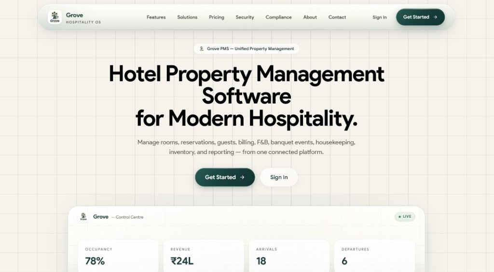
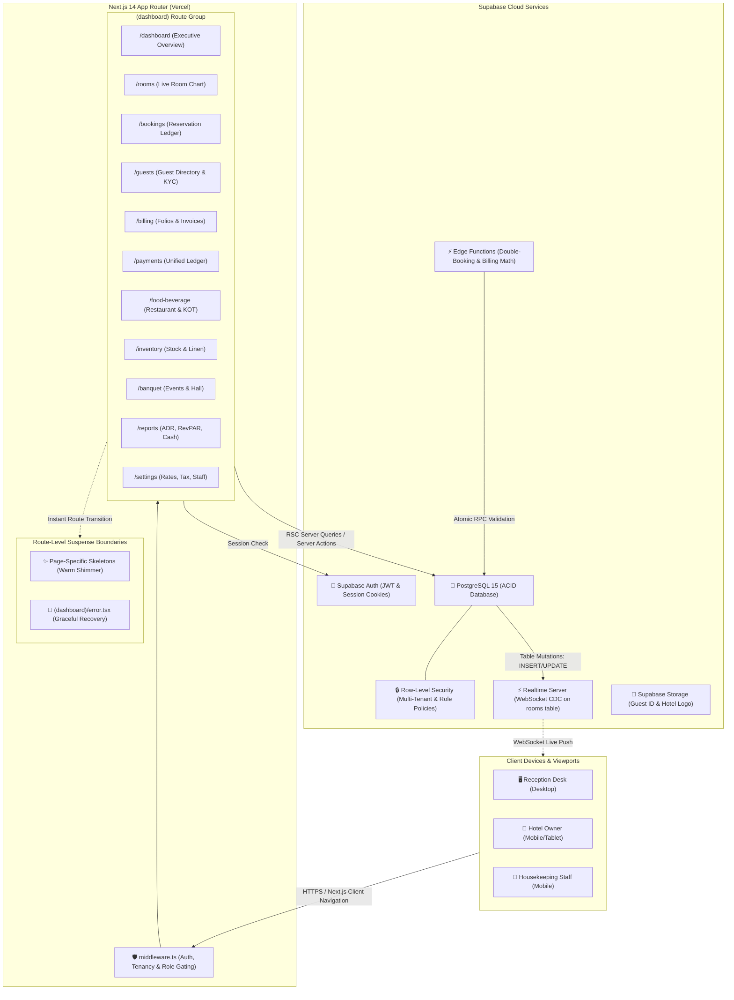
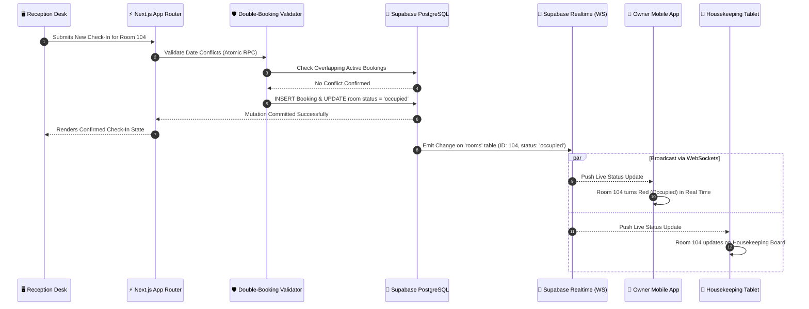
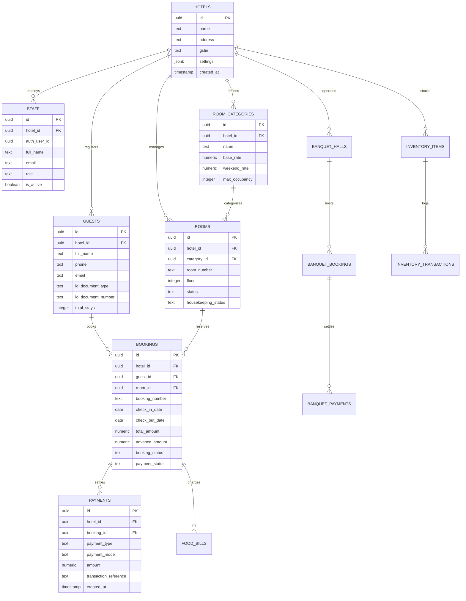

<div align="center">

# 🌲 Grove PMS
### Unified Hotel Property Management Software & Hospitality OS

[](https://nextjs.org/)
[](https://react.dev/)
[](https://www.typescriptlang.org/)
[](https://tailwindcss.com/)
[](https://supabase.com/)
[](https://razorpay.com/)

**An end-to-end, multi-tenant Hotel Property Management System engineered for boutique hotels, luxury resorts, homestays, and hospitality operators.**

[Live Platform](https://www.grovepms.me) • [Key Features](#4-the-11-core-operating-modules) • [System Architecture](#5-system-architecture) • [Visual Room Builder](#3-visual-room--floor-builder) • [Getting Started](#10-getting-started)

<br />



</div>

---

## 📑 Table of Contents

- [1. Executive Summary & Vision](#1-executive-summary--vision)
- [2. Platform Highlights](#2-platform-highlights)
- [3. Visual Room & Floor Builder](#3-visual-room--floor-builder)
- [4. The 11 Core Operating Modules](#4-the-11-core-operating-modules)
- [5. System Architecture](#5-system-architecture)
  - [High-Level Architectural Diagram](#high-level-architectural-diagram)
  - [Realtime Synchronization Flow](#realtime-synchronization-flow)
  - [Database Entity-Relationship Diagram (ERD)](#database-entity-relationship-diagram-erd)
- [6. Role-Based Access Control (RBAC)](#6-role-based-access-control-rbac)
- [7. Design System & UX Engineering](#7-design-system--ux-engineering)
  - [Google Sans Editorial Typography](#google-sans-editorial-typography)
  - [Architectural Line Grid & Glassmorphism](#architectural-line-grid--glassmorphism)
  - [Hardware-Accelerated Warm Shimmer Skeletons](#hardware-accelerated-warm-shimmer-skeletons)
- [8. Technology Stack](#8-technology-stack)
- [9. Directory & Project Structure](#9-directory--project-structure)
- [10. Getting Started](#10-getting-started)
  - [Prerequisites](#prerequisites)
  - [Environment Configuration](#environment-configuration)
  - [Installation & Running Locally](#installation--running-locally)
- [11. Reference Deployment — Hotel Greenery View](#11-reference-deployment--hotel-greenery-view)
- [12. Deployment & Production Operations](#12-deployment--production-operations)

---

## 1. Executive Summary & Vision

Hotels historically operate with fractured tools: manual paper registers, disconnected spreadsheet ledgers, separate restaurant billing software, and ad-hoc phone calls to track room cleaning status. 

**Grove PMS** consolidates entire hotel operations into a single, cohesive, cloud-native control centre:

- **1-Minute Walk-In Check-In:** Front desk reception can create reservations, assign rooms, record guest ID proofs (Aadhaar, Passport, Driving License), and issue keys in under 60 seconds.
- **Zero Double-Bookings:** Server-side date-overlap validation guarantees conflicting reservations are mathematically impossible.
- **Sub-Second Realtime Synchronization:** When reception marks a room as *Occupied* or housekeeping flags a room *Clean*, all active screens (desktop terminals, owner smartphones, housekeeping tablets) update instantly via WebSockets without manual refreshes.
- **Unified Departmental Ledger:** Cross-department collections across Accommodation, Banquet Events, and Food & Beverage POS feed into a consolidated financial registry.
- **Enterprise Multi-Tenancy:** Secure Row-Level Security (RLS) ensures clean isolation across hotels, owners, managers, and staff members.

---

## 2. Platform Highlights

| Capability | Description |
|---|---|
| **Multi-Tenant SaaS Onboarding** | 4-step animated registration flow with property configuration, dynamic address validation, operational modules selection, and owner credentialing. |
| **Visual Category & Floor Builder** | Category-first room configuration where hotel owners build their floor plans and room inventories using movable visual components and automatic room number generators. |
| **Realtime Housekeeping Board** | Color-coded matrix (`Clean`, `Dirty`, `Inspected`) with 1-click status transitions and mobile-optimized inspection workflows. |
| **Restaurant POS & Live KOT** | Direct-to-kitchen order tickets, room folio food charging, table-side ordering, and daily F&B turnover tracking. |
| **GST-Ready Folio Billing** | Automatic CGST + SGST tax breakdown, SAC code labeling, corporate billing, and printable A4 tax invoices. |
| **Executive Performance Intelligence** | Real-time calculations of ADR (Average Daily Rate), RevPAR (Revenue Per Available Room), occupancy curves, and daily cash reconciliation. |

---

## 3. Visual Room & Floor Builder

Grove PMS replaces tedious manual room entry with an intuitive **Category-First, Floor-Wise Room Configuration Builder**:

```
[ Room Categories ] ──► [ Rate & Occupancy Rules ] ──► [ Floor Allocation ] ──► [ Auto-Generated Rooms ]
```

1. **Central Category Configuration**: Define room tiers (e.g., *Standard*, *Deluxe*, *Executive Suite*, *Family Villa*) with base rates, extra guest surcharges, child charges, adult capacity, and amenities.
2. **Interactive Floor Allocation**: Drag or assign category quantities into individual floors (Ground Floor, Floor 1, Floor 2, etc.).
3. **Automatic Room Number Generation**: Sequentially numbers rooms based on floor tiers (e.g., Floor 1 Deluxe &times; 4 &rarr; 101, 102, 103, 104) while preventing numbering collisions.
4. **Live Inventory Distribution**: Real-time summary computing total capacity, expected nightly turnover, and category mix.

---

## 4. The 11 Core Operating Modules

| Module | Route | Key Capabilities |
|---|---|---|
| **1. Control Centre** | `/dashboard` | Operational control centre: real-time room occupancy cards, quick-action shortcuts, floor-by-floor room grid, today's collections, and arrivals/departures tracking. |
| **2. Room Matrix** | `/rooms` | Visual live accommodation grid across units. Realtime housekeeping toggles (`Clean`, `Dirty`, `Inspected`), floor grouping, and category filters. |
| **3. Bookings Registry** | `/bookings` | Unified reservation registry with debounced search, date ranges, calendar schedule view, automated status tracking (*Confirmed*, *Checked In*, *Checked Out*, *Cancelled*), and check-in workflows. |
| **4. Guest Directory** | `/guests` | Searchable guest profiles, contact records, repeat-stay identification, masked ID document records (Aadhaar, Passport, Driving License), and lifetime stay history. |
| **5. Billing & Folios** | `/billing` | Guest folio management: combines room charges, extra nights, and room-service food bills. Configurable GST / Non-GST toggles with real-time tax calculation and A4 printable statements. |
| **6. Payments Ledger** | `/payments` | Unified cross-department financial transaction ledger covering Rooms, Banquet events, and F&B sales. Filter by payment method (Cash, UPI, Card, Bank Transfer) with CSV export. |
| **7. Food & Beverage** | `/food-beverage` | Restaurant POS & Room Service: live Kitchen Order Tickets (KOT), dining bill generation, daily food revenue analytics, and menu item pricing control. |
| **8. Inventory & Assets** | `/inventory` | Property asset management for linens, toiletries, pantry consumables, and appliances. Low-stock alerts, damaged asset logs, wastage records, and replacement scheduling. |
| **9. Banquet & Events** | `/banquet` | Event booking manager: half-day & full-day reservation slots, convention and wedding hosting, advance collection tracking, and amenity management. |
| **10. Reports & Analytics** | `/reports` | Executive performance intelligence: Average Daily Rate (ADR), Revenue per Available Room (RevPAR), occupancy curves, daily cash reconciliation audit, and P&L analytics. |
| **11. Settings & Staff** | `/settings` | Property configuration: staff account credentialing, role permission assignments, seasonal room category pricing, and hotel GST / tax profile setup. |

---

## 5. System Architecture

### High-Level Architectural Diagram

The system employs a server-first Next.js 14 App Router architecture backed by Supabase Managed Postgres with Row-Level Security (RLS) and real-time CDC (Change Data Capture) push notifications.



---

### Realtime Synchronization Flow

A core architectural pillar is immediate state synchronization across distributed hotel terminals.



---

### Database Entity-Relationship Diagram (ERD)

Every entity is scoped by `hotel_id` to guarantee multi-tenant data isolation and security.



---

## 6. Role-Based Access Control (RBAC)

Security is enforced at two distinct layers:
1. **Next.js Middleware (`middleware.ts`)**: Evaluates staff authentication, session expiry, and route permissions on every incoming request.
2. **PostgreSQL Row-Level Security (RLS)**: Enforces database-level tenant and role isolation even if client-side code is manipulated.

| Module / Capability | 👑 Owner | 🛡️ Manager | 🛎️ Reception | 🧹 Housekeeping |
|---|:---:|:---:|:---:|:---:|
| **Dashboard Overview** | Full Access | Full Access | Full Access | Read-Only Summary |
| **Room Chart Matrix** | Full Access | Full Access | Full Access | Housekeeping Status Only |
| **Bookings & Check-In** | Full Access | Full Access | Full Access | ❌ No Access |
| **Billing & Folios** | Full Access | Full Access | Full Access | ❌ No Access |
| **Payments Ledger** | Full Access | Full Access | Full Access | ❌ No Access |
| **Guest KYC Directory** | Full Access | Full Access | Full Access | ❌ No Access |
| **Food & Beverage POS** | Full Access | Full Access | Full Access | Kitchen KOT Only |
| **Inventory & Assets** | Full Access | Full Access | Read-Only | Report Damage & Usage |
| **Banquet & Events** | Full Access | Full Access | Create & View | Read-Only Events |
| **Executive Reports (ADR/RevPAR)** | Full Access | Full Access | ❌ No Access | ❌ No Access |
| **Settings & Staff Credentials** | Full Access | ❌ No Access | ❌ No Access | ❌ No Access |

---

## 7. Design System & UX Engineering

### Google Sans Editorial Typography
The entire application utilizes **Google Sans** (`400`, `500`, `600`, `700`) as the foundational typography system across all heading tiers, body copy, form controls, badges, and dashboard data metrics.

### Architectural Line Grid & Glassmorphism
Public landing pages, feature deep dives, and onboarding workflows feature a crisp architectural background line grid (`.grove-grid-texture opacity-85`) combined with translucent frosted glass cards, subtle borders, and deep brand accents (`#1F3D3A` Brand Forest, `#F6F2EC` Sand).

### Hardware-Accelerated Warm Shimmer Skeletons
To achieve zero layout shifts (Cumulative Layout Shift = 0) and an instantaneous feel during page transitions:

```css
.pms-skeleton {
  @apply relative overflow-hidden rounded bg-brand-sand-dark/65;
}

.pms-skeleton::after {
  content: '';
  position: absolute;
  inset: 0;
  transform: translateX(-100%);
  background: linear-gradient(
    90deg,
    transparent 0%,
    rgba(255, 255, 255, 0.45) 50%,
    transparent 100%
  );
  animation: pmsShimmer 1.5s cubic-bezier(0.4, 0, 0.2, 1) infinite;
}

@media (prefers-reduced-motion: reduce) {
  .pms-skeleton::after {
    animation: none !important;
    display: none !important;
  }
}
```

---

## 8. Technology Stack

- **Framework**: [Next.js 14 (App Router)](https://nextjs.org/)
- **Language**: [TypeScript 5.5](https://www.typescriptlang.org/)
- **UI & Design Tokens**: [Tailwind CSS 3.4](https://tailwindcss.com/)
- **Typography**: [Google Sans](https://fonts.google.com/) via `@fontsource/google-sans`
- **Database & Auth**: [Supabase](https://supabase.com/) (PostgreSQL 15, Row-Level Security, Edge Functions)
- **Realtime Engine**: Supabase Realtime WebSocket client (`@supabase/ssr`, `@supabase/supabase-js`)
- **Subscription & Payments**: [Razorpay](https://razorpay.com/) Server-to-Server Checkout & Webhooks
- **Icons**: [Lucide React](https://lucide.dev/)
- **Schema Validation**: [Zod 3.23](https://zod.dev/)
- **Motion**: [Framer Motion](https://www.framer.com/motion/)

---

## 9. Directory & Project Structure

```text
Booking_Software/
├── app/                                 # Next.js 14 App Router
│   ├── (auth)/                          # Authentication & Onboarding
│   │   ├── login/                       # Staff login & session creation
│   │   └── register-hotel/              # 4-step multi-tenant hotel registration
│   ├── (dashboard)/                     # Authenticated PMS module routes
│   │   ├── layout.tsx                   # Persistent sidebar, top bar & AuthProvider
│   │   ├── loading.tsx                  # Root fallback loading skeleton
│   │   ├── error.tsx                    # Graceful error boundary
│   │   ├── dashboard/                   # Module 1: Dashboard overview
│   │   ├── rooms/                       # Module 2: Room chart & matrix
│   │   ├── bookings/                    # Module 3: Booking registers & calendar
│   │   ├── guests/                      # Module 4: Guest directory & KYC
│   │   ├── billing/                     # Module 5: Billing folios & invoices
│   │   ├── payments/                    # Module 6: Cross-department ledger
│   │   ├── food-beverage/               # Module 7: Restaurant POS & KOT
│   │   ├── inventory/                   # Module 8: Stock, assets & linen
│   │   ├── banquet/                     # Module 9: Banquet hall & events
│   │   ├── reports/                     # Module 10: Performance intelligence & ADR
│   │   └── settings/                    # Module 11: Hotel, staff & rates
│   ├── features/                        # Dedicated SEO feature landing pages
│   ├── hotel-management-software/       # Comprehensive software overview
│   ├── subscription/                    # Billing plans & payment flow
│   └── globals.css                      # Design system tokens, grid & shimmer animations
├── components/
│   ├── landing/                         # Public marketing & conversion components
│   ├── rooms/                           # Visual Category & Floor Room Builder
│   ├── skeletons/                       # Page-specific skeleton loaders
│   ├── shared/                          # Reusable UI primitives (Buttons, Modal, TopBar)
│   ├── bookings/                        # Reservation dialogs & schedule views
│   ├── billing/                         # Folio tables & A4 print invoices
│   └── fb/                              # KOT boards & POS billing interfaces
├── lib/
│   ├── auth/                            # Session resolution & account switching
│   ├── rooms/                           # Visual builder actions & room generation logic
│   ├── supabase/                        # SSR cookie & server client factories
│   └── utils/                           # Currency formatting (INR ₹), dates & ID helpers
├── supabase/
│   ├── migrations/                      # Version-controlled SQL migrations
│   └── functions/                       # Edge functions (double-booking validation, night audit)
└── middleware.ts                        # Route protection & role verification
```

---

## 10. Getting Started

### Prerequisites

- **Node.js**: v18.17.0 or later (Node 20+ recommended)
- **Package Manager**: `npm` (v9+) or `pnpm`
- **Supabase Project**: Managed PostgreSQL instance with Realtime enabled

### Environment Configuration

Create a `.env.local` file in the root directory:

```env
# Supabase Configuration
NEXT_PUBLIC_SUPABASE_URL=https://your-project-id.supabase.co
NEXT_PUBLIC_SUPABASE_ANON_KEY=your-anon-key

# Service Role Key (Server-side admin scripts & webhooks only)
SUPABASE_SERVICE_ROLE_KEY=your-service-role-key

# Razorpay Subscriptions (Optional for paid plans)
RAZORPAY_KEY_ID=your-razorpay-key-id
RAZORPAY_KEY_SECRET=your-razorpay-key-secret
```

### Installation & Running Locally

1. **Clone the repository:**
   ```bash
   git clone https://github.com/vineetvardhan27/Booking_Sofware.git
   cd Booking_Sofware
   ```

2. **Install project dependencies:**
   ```bash
   npm install
   ```

3. **Verify TypeScript compilation:**
   ```bash
   npx tsc --noEmit
   ```

4. **Start the local development server:**
   ```bash
   npm run dev
   ```

5. Open [http://localhost:3000](http://localhost:3000) in your browser.

---

## 11. Reference Deployment — Hotel Greenery View

Grove PMS is actively deployed in live production powering **Hotel Greenery View** (Gangtok, Sikkim):

- **19 Accommodation Units:** 18 Deluxe/Standard Rooms + Basement Family Suite.
- **4 Operational Staff Tiers:** Hotel Owner, Property Manager, Front Desk Reception, and Housekeeping.
- **Integrated Operations:** Unified live ledger syncing Front Desk Check-in, Restaurant KOT dining charges, Banquet events, and automated midnight audits.

---

## 12. Deployment & Production Operations

- **Vercel Edge Hosting**: Continuous zero-downtime deployment with automatic preview branch builds and global CDN caching.
- **Database Migrations**: Version-controlled migrations applied through the Supabase CLI:
  ```bash
  npx supabase db push
  ```
- **Zero-Maintenance Serverless Architecture**: Fully stateless web tier backed by managed PostgreSQL. Database backups, SSL certificates, WebSocket channels, and edge routing are handled natively.

---

<div align="center">

*Engineered with precision for modern hospitality by **Vineet Vardhan**.*

</div>
